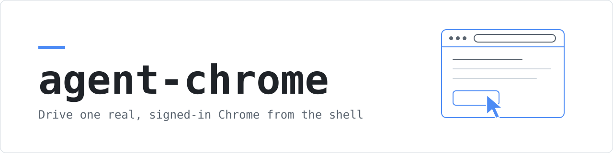
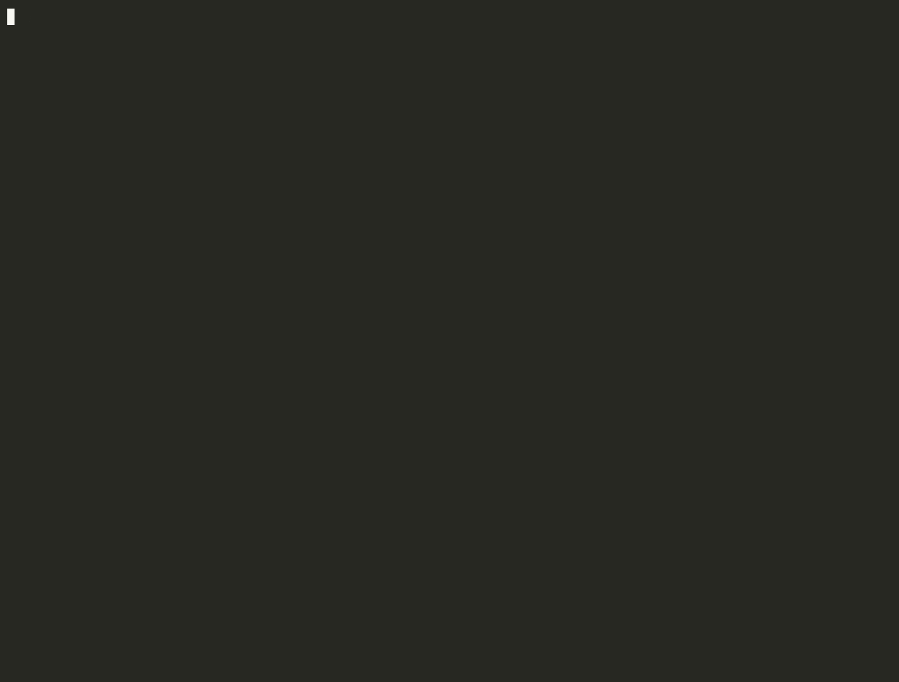

<div align="center">

<picture>
  <source media="(prefers-color-scheme: dark)" srcset="docs/assets/banner-dark.svg">
  
</picture>

# agent-chrome

### Drive one real, signed-in Chrome from the shell

**Gives a coding agent such as Claude Code one real Chrome to click, type and read in, and after every action tells it what changed on the page.**

[](LICENSE)
[](#platforms)
[](#quick-start)
[](#quick-start)
[](bin/agent-chrome)

[Quick start](#quick-start) · [Platforms](#platforms) · [How it works](#how-it-works) · [Why I wrote it](#why-i-wrote-it) · [Tests](#tests) · [Limits](#limits)

<code>git clone https://github.com/minomat180/agent-chrome && agent-chrome/bin/agent-chrome-ctl start</code>

<br><br>



<sub>A real recording of the loop: <code>open</code> lists the page with refs, each <code>fill</code> and <code>click</code> prints what changed. Made with <a href="docs/demo/play.sh">docs/demo/play.sh</a> against a throwaway browser; httpbin.org echoes the submitted form.</sub>

</div>

---

agent-chrome is two shell commands: `agent-chrome` drives pages over the Chrome
DevTools Protocol, `agent-chrome-ctl` starts and updates the browser it drives.
I wrote it because the browser tooling my agents used failed one call in eleven
and was easy for sites to detect. I use it daily from Claude Code on a NixOS
server and a Mac.

- **Every action reports what changed.** `open` lists what can be acted on and
  gives each element a ref (`e1`, `e10`); every `fill` or `click` answers with
  the changed and new elements, new text and URL changes, so the agent rarely
  needs another snapshot or a screenshot.
- **One browser, attached, never launched.** `agent-chrome` only connects to
  `127.0.0.1:$AGENT_CHROME_PORT`. If nothing is there it fails and says to run
  `agent-chrome-ctl start`, so an agent cannot fall back to an anonymous
  headless browser.
- **No automation signal from the driver.** It never sends `Runtime.enable`,
  reads in an isolated world and clicks with trusted input events. On
  bot-detector.rebrowser.net it scored 0 red and 0 yellow, where four other
  drivers scored 2 or 3 red.
- **A tab per agent session.** Sessions are keyed by `AGENT_CHROME_SESSION` or
  Claude Code's `CLAUDE_CODE_SESSION_ID`, and `agent-chrome tabs` shows who owns
  which tab.
- **Secrets typed from stdin.** `agent-chrome secret <target>` types a password
  piped from a password manager key by key and masks the field in later reports.
- **No daemon, no npm dependencies.** Each call connects, acts and exits; a read
  such as `agent-chrome get title` takes about 0.1 s end to end.

> [!IMPORTANT]
> The browser is signed in to real accounts and CDP has no authentication.
> Chrome listens on `127.0.0.1` only, but any process on the same machine, under
> any user account, can use the port. Run it on a machine only you use. Details
> in [SECURITY.md](SECURITY.md).

> [!NOTE]
> This is a personal tool for my own two machines. It is not packaged, and I am
> not trying to grow it into a general project. [skill/SKILL.md](skill/SKILL.md)
> is the manual my own agents load, so it refers to my setup.

## Quick start

| Platform | Needs |
|---|---|
| Everywhere | Node 22 or newer, bash, python3, curl |
| Linux | [cage](https://github.com/cage-kiosk/cage) and `wlr-randr`; gpg, `ar`, tar and sha256sum for `agent-chrome-ctl update` |
| macOS | nothing else |

```sh
git clone https://github.com/minomat180/agent-chrome && cd agent-chrome
export PATH="$PWD/bin:$PATH"

agent-chrome-ctl start            # Chrome with its own profile, CDP on 127.0.0.1:9222
agent-chrome open example.com     # this session's tab; prints the elements with refs
agent-chrome click "text=Learn more"
agent-chrome close                # closes this session's tabs
```

If no Chrome is installed yet, run `agent-chrome-ctl update` before `start`.
There is no build step.

| Command | What it does |
|---|---|
| `agent-chrome open <url>` | go to a URL in this session's tab and list the page with refs |
| `agent-chrome click`, `fill`, `select`, `check`, `hover` | act on a ref, `text=Label`, a CSS selector or `x,y`, then report what changed |
| `agent-chrome press <key>`, `type <text>` | keys and text to whatever has focus |
| `agent-chrome text`, `read`, `get`, `shot` | read the page or one element, or save a screenshot to a file |
| `agent-chrome secret <target>` | type a secret from stdin into a field, never echoed |
| `agent-chrome run` | run a batch of commands from stdin, stopping at the first error |
| `agent-chrome help` | every command and flag |
| `agent-chrome-ctl login <url>` / `background` | show the browser to sign in by hand, then hide it again |

For Claude Code, link the agent manual as a skill:
`ln -s "$PWD/skill" ~/.claude/skills/agent-chrome`.

<details>
<summary>Environment variables</summary>

| Variable | Default |
|---|---|
| `AGENT_CHROME_PORT` | `9222` |
| `AGENT_CHROME_HOME` | `~/.local/share/agent-chrome` |
| `AGENT_CHROME_PROFILE` | `$AGENT_CHROME_HOME/chrome-profile` |
| `AGENT_CHROME_SIZE` | `1920x1080` |
| `AGENT_CHROME_BIN` | the private Chrome, else the system one |
| `AGENT_CHROME_STATE_DIR` | `$XDG_RUNTIME_DIR/agent-chrome` (or `/tmp/agent-chrome`) |
| `AGENT_CHROME_SESSION` | else `CLAUDE_CODE_SESSION_ID`, else `default` |
| `AGENT_CHROME_NODE` | macOS only: the `node` that runs the window helper and the unload guard |

</details>

## Platforms

| | Linux | NixOS | macOS |
|---|---|---|---|
| Browser runs in | a headless `cage` compositor | a headless `cage` compositor | a minimised window |
| Chrome comes from | `agent-chrome-ctl update` (Google's apt repo, signature checked) | nixpkgs `google-chrome` | `agent-chrome-ctl update` (Google's DMG, code signature checked) |
| Started at boot or login by | your choice | a systemd user service | a LaunchAgent |
| `login` / `background` | restart the browser | restart the browser | un-minimise / minimise, tabs survive |

### Linux

Chrome runs headful inside a headless `cage` compositor: hardware GL where the
machine has a GPU and a normal user agent, but no window on anyone's screen.
`agent-chrome-ctl update` installs the current stable Chrome into
`~/.local/share/agent-chrome/chrome/<version>` after checking Google's signature
on the apt `Release` file and the hash chain down to the `.deb`; `status` warns
when the running Chrome is a major version behind.

### NixOS

Google's prebuilt binary does not run unpatched, so `agent-chrome-ctl` uses
`google-chrome-stable` from nixpkgs and `update` defers to `nixos-rebuild`. What
my server runs, with `bin/*` linked into `~/.local/bin` (the scripts resolve
symlinks to find `lib/` and `libexec/`):

```nix
environment.systemPackages = with pkgs; [ google-chrome cage wlr-randr ];  # google-chrome is unfree
hardware.graphics.enable = true;   # without it Chrome has no GL at all
users.users.<you>.linger = true;    # start the user service at boot
systemd.user.services.agent-chrome = {
  wantedBy = [ "default.target" ];
  path = [ "/run/current-system/sw" "/run/wrappers" ];
  serviceConfig = {
    Type = "oneshot";
    RemainAfterExit = true;
    ExecStart = "%h/.local/bin/agent-chrome-ctl start";
    ExecStop = "%h/.local/bin/agent-chrome-ctl stop";
  };
};
```

> [!TIP]
> A headless server has no screen for `agent-chrome-ctl login`. Sign in through
> an SSH tunnel to port 9222 and `chrome://inspect` in a local Chrome instead.

### macOS

`agent-chrome-ctl` hands over to `bin/agent-chrome-ctl-macos`, with the same
commands. `update` installs Google's universal Chrome privately after checking
its code signature (Team ID `EQHXZ8M8AV`) and Gatekeeper. There is no cage, so
"background" means minimised: Chrome is launched hidden, given one window over
CDP and kept minimised, and focus emulation keeps its tabs rendering. `login`
and `background` un-minimise and minimise it without a restart, so tabs and
session cookies survive. `lib/unload-guard.mjs` accepts "Leave site?" dialogs,
which otherwise blocked logout and shutdown behind a window nobody could see. I
start it at login with a LaunchAgent that runs `agent-chrome-ctl start`.

## How it works

- **No daemon.** Each call connects to the browser, acts, saves a little state
  in `$AGENT_CHROME_STATE_DIR/<session>.json` and exits.
- **One shared window.** All session tabs live in one window. A background tab
  does not render, so each call brings its own tab to the front first.
  `agent-chrome gc` closes tabs of sessions idle for 6 h (`--older N` to change
  that).
- **`Runtime.enable` is never sent.** [lib/cdp.mjs](lib/cdp.mjs) refuses it.
  Reads run in an isolated world (`Page.createIsolatedWorld`) that page scripts
  cannot see; `eval --main` opts into the page's own world.
- **Trusted input.** Clicks and keys are `Input.dispatch*` events
  (`event.isTrusted === true`) aimed at hit-tested coordinates, so they work
  through open and closed shadow DOM and cross-site iframes. A click on an
  element covered by a modal reports what covers it.
- **Refs are DOM node ids.** Each ref maps to a `backendNodeId`, so `e12`
  stays valid while that node exists and is refused once the document is
  replaced.
- **Dialogs are answered inside the call.** `alert` is accepted; `confirm` and
  `prompt` are dismissed unless the command repeats with `--accept`.
- **Secrets are masked, not sandboxed.** A field filled with `agent-chrome
  secret` shows as hidden in later snapshots, change reports and `get value`, so
  a password does not land in the agent's context by accident. `eval` can still
  read it.

`agent-chrome-ctl` signals only processes it started (pidfiles, checked against
the live process, and a private process name), and never adds
`--enable-automation`, `--headless` or `--no-sandbox`.

## Why I wrote it

Before this, my agents used a browser tool for the pi coding harness that wraps
[agent-browser](https://github.com/vercel-labs/agent-browser). I went through
the session logs on 2026-11-12 before replacing it:

- **2,015 calls across 45 sessions, 181 failures (9.0%).** 50 were "stale ref"
  rejections, 33 validation errors, 29 tab-verification errors, 10 version
  mismatches between the wrapper and the CLI it wrapped.
- **By default it launched its own headless Chrome** (`HeadlessChrome/151`,
  `navigator.webdriver === true`), which sat on Cloudflare's "Just a moment..."
  page while the same URL passed in a normal Chrome. By a rough
  classification, 14 of the 21 bot walls in the logs came from that browser.
- **Even attached to the real browser it was detectable.** On
  [bot-detector.rebrowser.net](https://bot-detector.rebrowser.net/), in the
  same Chrome:

| Driver | Failed checks (red) | Warnings (yellow) |
|---|---|---|
| playwright-cli 0.1.24 | 3 (sourceUrl leak, main world, Runtime.enable) | 1 |
| chrome-devtools-mcp CLI 1.13.0 | 3 (same three) | 1 |
| agent-browser 0.42.0 | 2 (main world, Runtime.enable) | 1 |
| browser-harness 0.1.13 | 2 (main world, Runtime.enable) | 1 |
| **agent-chrome** | **0** | **0** |

The yellow came from the browser, not the driver: Chrome inside a headless
compositor has no pointer device and reports `(hover: none)`. `agent-chrome-ctl`
adds a virtual pointer device on Linux. How to reproduce the table:
[test/compare/README.md](test/compare/README.md).

None of the existing drivers avoided `Runtime.enable`, the best-known CDP
automation signal. browser-harness came closest, but it sends each script's
source and the tail of its output to PostHog (version 0.1.13) unless
`BH_TELEMETRY=0` is set, which I did not want next to signed-in accounts. So I
wrote a small driver and kept their good ideas: accessibility-tree refs that
re-resolve when used, and input dispatched at the compositor level.

## Tests

```sh
test/run.sh      # 123 end-to-end checks in a throwaway Chrome on port 9557
```

The suite starts its own browser and a fixture server on `localhost:8765` and
never touches 9222. It covers forms (controlled inputs, date, contenteditable,
select, upload), secrets and masking, shadow DOM, same-origin and cross-site
iframes, covers and overlays, dialogs, hover, downloads, tabs, batches, two
concurrent sessions, and the pointer, `webdriver` and viewport checks. It passes
123/123 on NixOS (Chrome 157) and on macOS 26 (arm64).

## Limits

- Chromium only, and only a browser that is already running.
- No console or network log capture: both need long-lived listeners, and
  console capture needs `Runtime.enable`. `agent-chrome eval` and
  `agent-chrome cdp <Method> [json]` cover the occasional need.
- A dialog opened by something other than agent-chrome cannot be answered over
  CDP; the tab is reported as not responding.
- On Linux, `login`, `background` and `restart` restart the shared browser,
  closing every session's tabs and dropping session-only cookies.
- Iframes nested inside a cross-site iframe are not listed.
- It does not solve captchas. A human-looking browser sees fewer of them; when
  one appears, the agent is told to stop and ask.

## License

MIT, see [LICENSE](LICENSE). The driver borrows ideas from
[agent-browser](https://github.com/vercel-labs/agent-browser) and
browser-harness: refs from the accessibility tree and compositor-level input.
